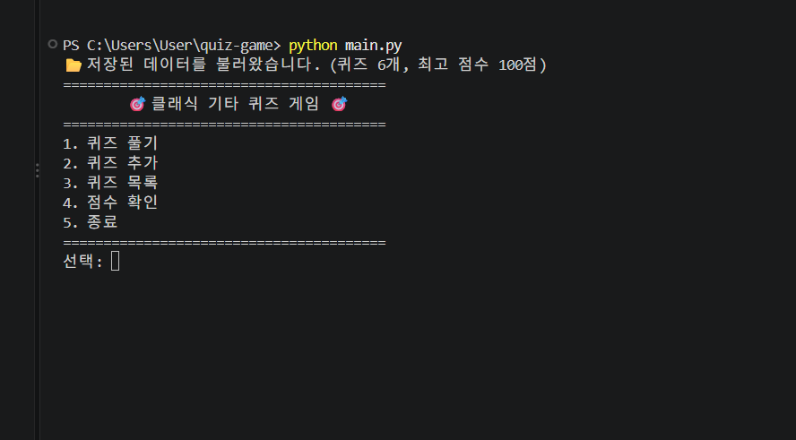
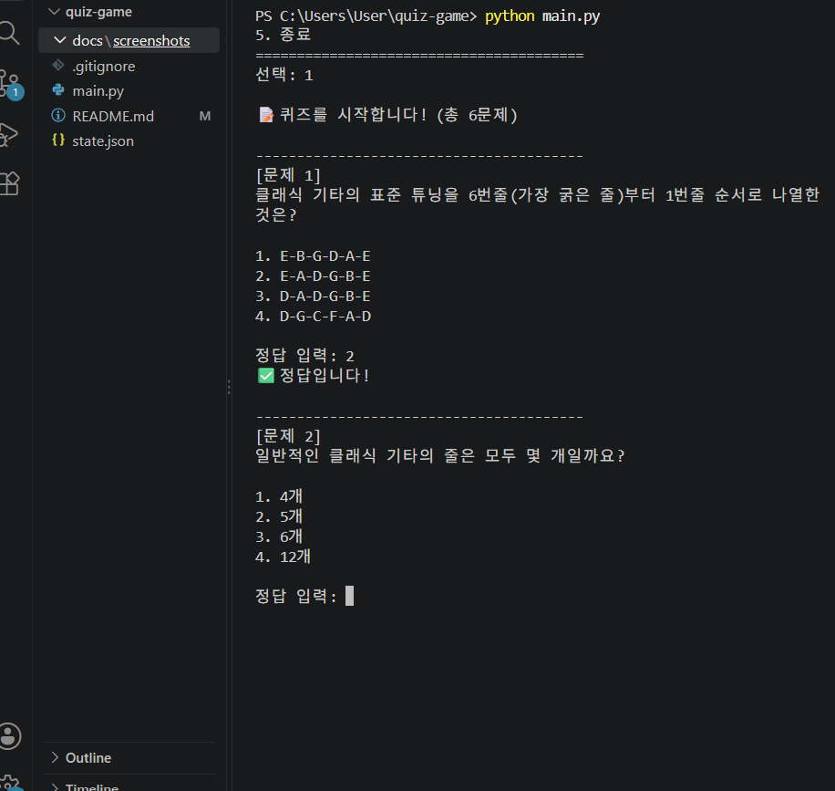
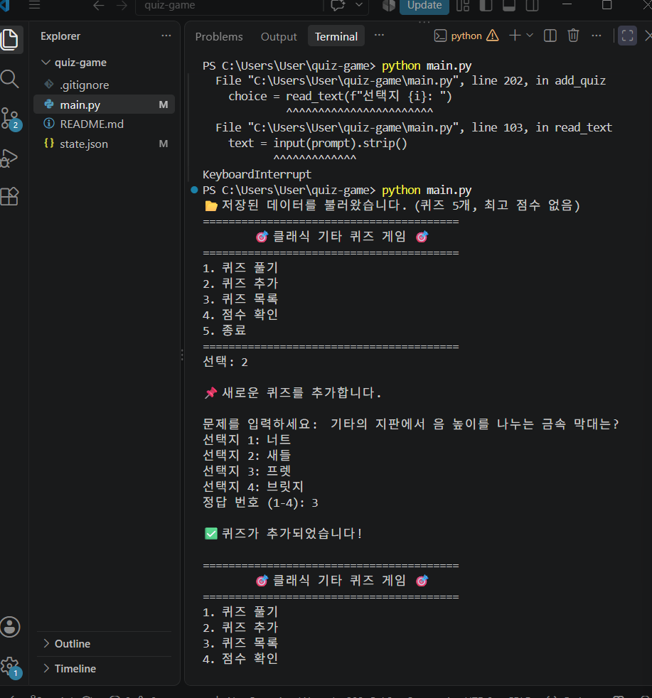
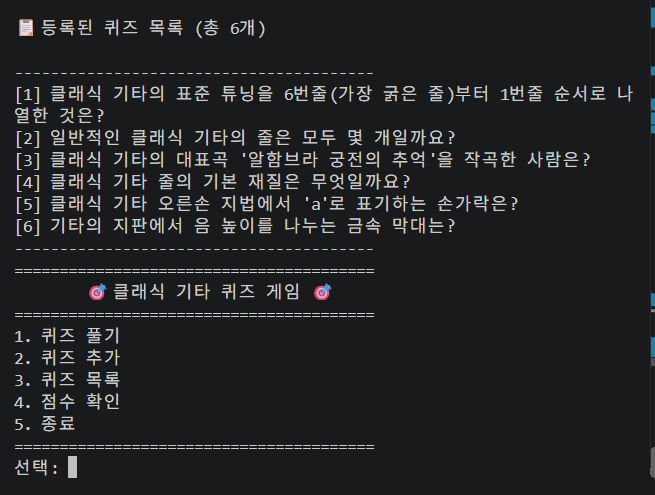
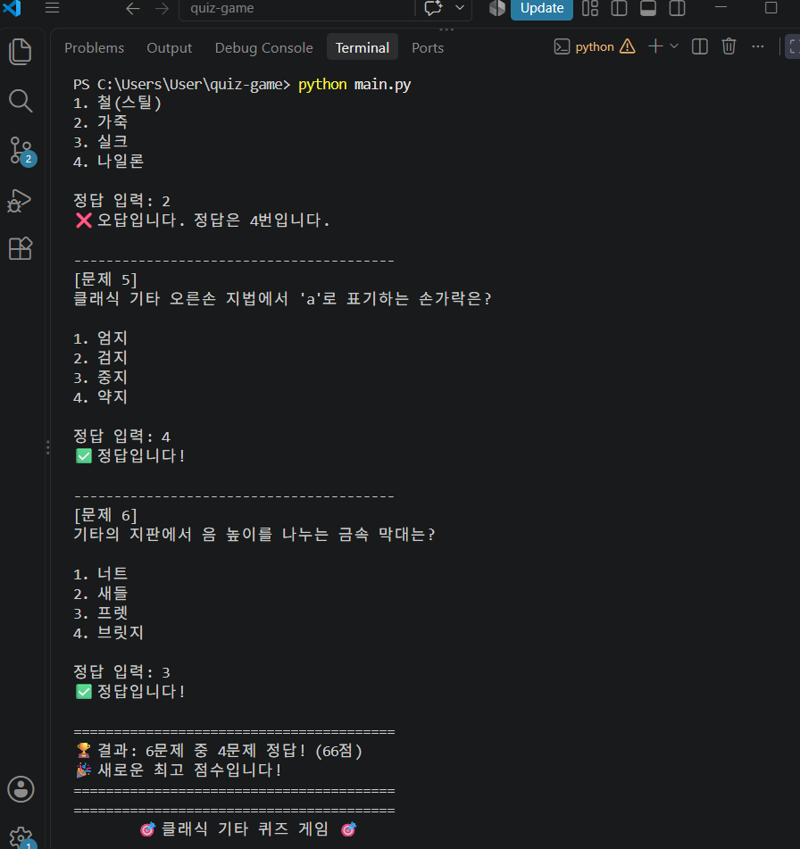

# 🎸 클래식 기타 퀴즈 게임

Python으로 만든 터미널(콘솔) 퀴즈 게임입니다.
클래식 기타에 관한 퀴즈를 풀고, 새 퀴즈를 직접 추가하고, 최고 점수를 기록할 수 있습니다.
프로그램을 종료해도 퀴즈와 최고 점수는 `state.json` 파일에 저장되어 다음 실행 때 그대로 불러옵니다.

---

## 1. 프로젝트 개요

| 항목 | 내용 |
|---|---|
| 프로젝트 이름 | quiz-game (클래식 기타 퀴즈 게임) |
| 형태 | 터미널에서 동작하는 Python 콘솔 프로그램 |
| 개발 언어 | Python 3.10 이상 |
| 사용 라이브러리 | 표준 라이브러리만 사용 (`json`, `pathlib`) |
| 데이터 저장 | 프로젝트 루트의 `state.json` (UTF-8) |

이 프로젝트의 목표는 Python 기본 문법(변수, 자료형, 조건문, 반복문, 함수)과 클래스를 사용해 하나의 프로그램을 처음부터 끝까지 완성하고, Git으로 작업 과정을 기록하는 것입니다.

---

## 2. 퀴즈 주제와 선정 이유

**주제: 클래식 기타**

평소 취미로서 클래식 기타를 연주하고 있습니다.
좋아하는 분야라서 문제와 선택지를 직접 만들기 쉬웠고, 튜닝, 줄의 재질, 대표곡과 작곡가, 오른손 지법 표기처럼
클래식 기타를 처음 접하는 사람도 알아 두면 좋은 기초 지식을 퀴즈로 정리해 보고 싶었습니다.

---

## 3. 실행 방법

### 실행 환경
- Python 3.10 이상
- 별도 설치가 필요한 외부 라이브러리 없음

### 실행 순서

```bash
# 1. 저장소 복제
git clone https://github.com/N-andyradio/quiz-game.git

# 2. 프로젝트 폴더로 이동
cd quiz-game

# 3. 실행
python main.py
```

> macOS/Linux에서는 `python` 대신 `python3`를 사용할 수 있습니다.

---

## 4. 기능 목록

### 메뉴

```
========================================
        🎯 클래식 기타 퀴즈 게임 🎯
========================================
1. 퀴즈 풀기
2. 퀴즈 추가
3. 퀴즈 목록
4. 점수 확인
5. 종료
========================================
```

| 번호 | 기능 | 설명 |
|---|---|---|
| 1 | 퀴즈 풀기 | 저장된 퀴즈를 순서대로 출제하고, 문제마다 정답/오답을 알려 줍니다. 모두 풀면 정답 수와 점수(100점 만점)를 보여 주고, 최고 점수를 넘으면 갱신합니다. |
| 2 | 퀴즈 추가 | 문제, 선택지 4개, 정답 번호(1~4)를 입력받아 새 퀴즈를 등록하고 바로 파일에 저장합니다. |
| 3 | 퀴즈 목록 | 등록된 퀴즈의 문제를 번호와 함께 보여 줍니다. (정답은 표시하지 않음) |
| 4 | 점수 확인 | 지금까지의 최고 점수를 보여 줍니다. |
| 5 | 종료 | 데이터를 저장하고 프로그램을 종료합니다. |

### 입력 및 예외 처리

| 상황 | 처리 |
|---|---|
| 입력 앞뒤 공백 (예: ` 1 `) | 공백을 제거한 뒤 처리 |
| 빈 입력 (그냥 Enter) | 안내 메시지 출력 후 다시 입력 |
| 숫자가 아닌 입력 (예: `abc`) | 안내 메시지 출력 후 다시 입력 |
| 범위 밖 숫자 (예: 메뉴 `9`, 정답 `0`) | 안내 메시지 출력 후 다시 입력 |
| 퀴즈가 하나도 없을 때 | 퀴즈 풀기/목록에서 안내 메시지 출력 |
| 아직 퀴즈를 풀지 않았을 때 | 점수 확인에서 안내 메시지 출력 |
| `Ctrl + C` / 입력 종료(EOF) | 안내 메시지 출력 후 데이터를 저장하고 안전하게 종료 |
| `state.json`이 없을 때 (첫 실행) | 기본 퀴즈 5개로 시작하고 파일 생성 |
| `state.json`이 손상되었을 때 | 안내 메시지 출력 후 기본 퀴즈로 복구 |

---

## 5. 파일 구조

```
quiz-game/
├── main.py              # 프로그램 전체 코드 (실행 파일)
├── state.json           # 퀴즈 목록과 최고 점수를 저장하는 데이터 파일
├── README.md            # 프로젝트 설명서
├── .gitignore           # Git이 추적하지 않을 파일 목록
└── docs/
    └── screenshots/     # 실행 화면 스크린샷
```

### `main.py` 코드 구성

| 구분 | 이름 | 역할 |
|---|---|---|
| 클래스 | `Quiz` | 퀴즈 한 문제를 표현 (문제, 선택지 4개, 정답 번호) |
| | ㄴ `display()` | 문제와 선택지를 화면에 출력 |
| | ㄴ `check()` | 입력한 번호가 정답인지 확인 |
| | ㄴ `to_dict()` / `from_dict()` | JSON 저장용 dict ↔ Quiz 객체 변환 |
| 클래스 | `QuizGame` | 게임 전체를 관리 (퀴즈 목록, 최고 점수) |
| | ㄴ `run()` / `show_menu()` | 메뉴 출력과 선택에 따른 기능 실행 |
| | ㄴ `play()` | 퀴즈 출제, 채점, 결과 표시 |
| | ㄴ `update_best_score()` | 최고 점수 비교, 갱신, 저장 |
| | ㄴ `add_quiz()` | 새 퀴즈 입력, 등록, 저장 |
| | ㄴ `list_quizzes()` | 퀴즈 목록 출력 |
| | ㄴ `show_score()` | 최고 점수 출력 |
| | ㄴ `load_state()` / `save_state()` | `state.json` 불러오기 / 저장 |
| | ㄴ `reset_to_default()` | 기본 퀴즈로 초기화 |
| 함수 | `create_default_quizzes()` | 기본 퀴즈 5개 생성 |
| 함수 | `read_int()` | 범위 안의 정수 입력 (공백·빈 입력·문자·범위 검증) |
| 함수 | `read_text()` | 비어 있지 않은 문자열 입력 |
| 함수 | `main()` | 프로그램 시작점, `Ctrl + C`/EOF 처리 |

---

## 6. 데이터 파일 설명 (`state.json`)

### 경로
프로젝트 루트(`main.py`와 같은 폴더)의 `state.json`

### 역할
- 퀴즈 목록과 최고 점수를 저장해, 프로그램을 종료하고 다시 실행해도 데이터가 유지되도록 합니다.
- 프로그램 시작 시 불러오고, 퀴즈 추가·최고 점수 갱신·종료 시 저장합니다.
- UTF-8 인코딩으로 저장하며, 한글이 그대로 보이도록 `ensure_ascii=False` 옵션을 사용합니다.

### 스키마

| 키 | 자료형 | 설명 |
|---|---|---|
| `quizzes` | list | 퀴즈 목록 |
| `quizzes[].question` | str | 문제 |
| `quizzes[].choices` | list[str] | 선택지 4개 |
| `quizzes[].answer` | int | 정답 번호 (1~4) |
| `best_score` | int 또는 null | 최고 점수 (100점 만점). 아직 풀지 않았으면 `null` |

### 예시

```json
{
    "quizzes": [
        {
            "question": "일반적인 클래식 기타의 줄은 모두 몇 개일까요?",
            "choices": ["4개", "5개", "6개", "12개"],
            "answer": 3
        }
    ],
    "best_score": 100
}
```

---

## 7. 실행 화면

| 메뉴 | 퀴즈 풀기 |
|---|---|
|  |  |

| 퀴즈 추가 | 퀴즈 목록 |
|---|---|
|  |  |

| 점수 확인 |
|---|
|  |
> ¿Ã ¡Ÿ¿∫ clone/pull Ω«Ω¿¿ª ¿ß«ÿ ∫π¡¶«— ¿˙¿Âº“ø°º≠ √fl∞°«flΩ¿¥œ¥Ÿ.
